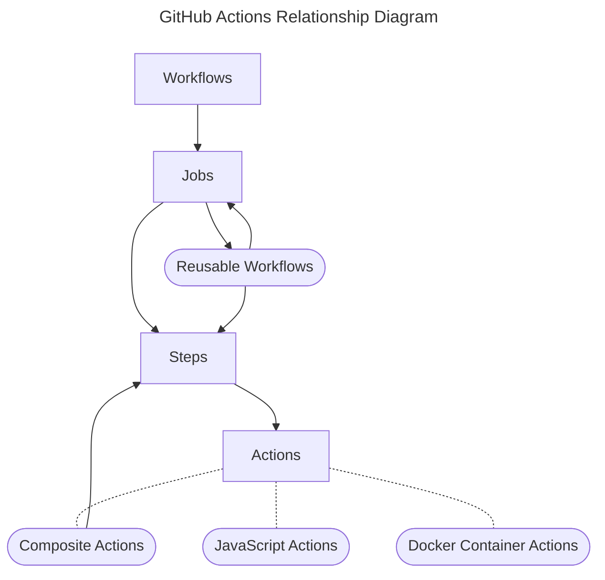

# .github

The devantler-tech organization's GitHub home: its public profile and community defaults, the
declarative configuration of the GitHub organization itself (`deploy/`), and the shared CI/CD
building blocks every product repository uses, documented below. To make a small, credential-free
documentation contribution, start with [Contributing](CONTRIBUTING.md). The
[repository contract](AGENTS.md) carries the detailed ownership and engineering rules.

New repositories deliberately enrolled in Renovate inherit the organization's
[onboarding preset](renovate-config.json): recommended updates with the Dependency Dashboard
disabled. Renovate [discovers this preset during onboarding](https://docs.renovatebot.com/config-presets/#grouporganization-level-presets).
Templates using Dependabot need no inactive Renovate config. Existing Renovate configurations
keep their own settings; this preset does not enroll repositories or replace them.

Workflow ownership follows three rules:

- Organization-required workflows cover pull-request concerns shared across repositories.
- Reusable workflows provide job-level behavior with more than one real caller;
  self-tests alone do not establish product reuse.
- A single-repository pipeline belongs in that repository, normally in its own CI/CD
  workflow, with local actions for smaller steps and repository rulesets for required checks.

The .NET package publisher is owned by [dotnet-template](https://github.com/devantler-tech/dotnet-template/blob/main/.github/workflows/publish.yaml),
not this shared catalogue. Other single-product publication jobs belong in their consuming repositories.

## Shared automation catalogue

The shared CI/CD building blocks used across devantler-tech projects — both **composite actions** and
**reusable `workflow_call` workflows** — in one maintained catalogue. Use this repository for new
consumers and changes. The former `maintenance` and `actions` repositories have been deleted after
migration; do not copy references from older examples. Their recovery limits and verified retirement
are recorded in [#84](https://github.com/devantler-tech/.github/issues/84) and
[#240](https://github.com/devantler-tech/.github/issues/240).

## Using them

An **action** is a step inside one of your jobs. A **reusable workflow** replaces a whole job. Both
are called by path from this repository, pinned to a full commit SHA:

```yaml
jobs:
  build:
    runs-on: ubuntu-latest
    steps:
      # an action — a step in your own job
      - uses: devantler-tech/.github/actions/setup-go-toolchain@<full-commit-sha> # vX.Y.Z

  release:
    # a reusable workflow — the whole job comes from here
    uses: devantler-tech/.github/.github/workflows/create-release.yaml@<full-commit-sha> # vX.Y.Z
    secrets:
      APP_PRIVATE_KEY: ${{ secrets.APP_PRIVATE_KEY }}
```

Replace `<full-commit-sha>` with the selected release's full 40-character commit SHA and `vX.Y.Z` with its version. The placeholders must be replaced before running these examples. The action and workflow indexes below link to their source or reference. Action READMEs and the collapsible workflow references describe the individual interfaces.

The diagram below shows how GitHub Workflows, Jobs, Steps, Reusable Workflows, and Actions relate.



## Actions

Each action reference documents its inputs, outputs and usage. The source link opens its executable
declaration. These are steps inside a caller-owned job, not required workflows.

<details>
<summary>Browse available interfaces</summary>

| Reference | Purpose | Source |
|-----------|---------|--------|
| [aggregate-job-checks](actions/aggregate-job-checks/README.md) | Aggregate multiple job results into a single required check | [action.yaml](actions/aggregate-job-checks/action.yaml) |
| [approve-pr](actions/approve-pr/README.md) | Approve a PR using a GitHub App identity | [action.yaml](actions/approve-pr/action.yaml) |
| [check-ci-run-budget](actions/check-ci-run-budget/README.md) | Opt-in, metadata-only 15-minute budget check for one exact completed workflow run | [action.yaml](actions/check-ci-run-budget/action.yaml) |
| [cleanup-ghcr-packages](actions/cleanup-ghcr-packages/README.md) | Clean up old GHCR packages | [action.yaml](actions/cleanup-ghcr-packages/action.yaml) |
| [create-issues-from-todos](actions/create-issues-from-todos/README.md) | Create GitHub issues from TODO comments, with optional project integration | [action.yaml](actions/create-issues-from-todos/action.yaml) |
| [dependency-review](actions/dependency-review/README.md) | Scan a PR's dependency changes for vulnerabilities and disallowed licenses | [action.yaml](actions/dependency-review/action.yaml) |
| [diagnose-flux](actions/diagnose-flux/README.md) | Dump Flux reconcile state, controller logs, and failing pod logs on a stuck deploy | [action.yaml](actions/diagnose-flux/action.yaml) |
| [enable-auto-merge-on-pr](actions/enable-auto-merge-on-pr/README.md) | Enable auto-merge on a pull request | [action.yaml](actions/enable-auto-merge-on-pr/action.yaml) |
| [free-disk-space](actions/free-disk-space/README.md) | Reclaim runner disk by removing large preinstalled toolchains | [action.yaml](actions/free-disk-space/action.yaml) |
| [guard-installed-skill-edits](actions/guard-installed-skill-edits/README.md) | Refuse a hand-edit to a synced installed-skill tree, naming its upstream | [action.yaml](actions/guard-installed-skill-edits/action.yaml) |
| [login-to-ghcr](actions/login-to-ghcr/README.md) | Login to GitHub Container Registry | [action.yaml](actions/login-to-ghcr/action.yaml) |
| [run-dotnet-tests](actions/run-dotnet-tests/README.md) | Test .NET solution or project with coverage | [action.yaml](actions/run-dotnet-tests/action.yaml) |
| [setup-agent-skills](actions/setup-agent-skills/README.md) | Install agent skills for one or more coding agents, with optional version pins | [action.yaml](actions/setup-agent-skills/action.yaml) |
| [setup-go-toolchain](actions/setup-go-toolchain/README.md) | Setup Go with private module discovery | [action.yaml](actions/setup-go-toolchain/action.yaml) |
| [setup-ksail-cli](actions/setup-ksail-cli/README.md) | Install KSail CLI via Homebrew | [action.yaml](actions/setup-ksail-cli/action.yaml) |
| [update-agent-skills](actions/update-agent-skills/README.md) | Update installed skills and report changes | [action.yaml](actions/update-agent-skills/action.yaml) |
| [upload-coverage](actions/upload-coverage/README.md) | Upload a Cobertura coverage report to GitHub Code Quality | [action.yaml](actions/upload-coverage/action.yaml) |
| [upsert-issue](actions/upsert-issue/README.md) | Create, update, reopen, or close a GitHub issue by title | [action.yaml](actions/upsert-issue/action.yaml) |
| [validate-naming](actions/validate-naming/README.md) | Validate Kubernetes manifest and machine patch names | [action.yaml](actions/validate-naming/action.yaml) |
| [validate-retired-repo-links](actions/validate-retired-repo-links/README.md) | Catch links to retired repositories with documented historical exceptions | [action.yaml](actions/validate-retired-repo-links/action.yaml) |
| [validate-shell-pipelines](actions/validate-shell-pipelines/README.md) | Detect early-exit assertions that can invert results under pipefail | [action.yaml](actions/validate-shell-pipelines/action.yaml) |

</details>

### Distribution

These are not on the GitHub Marketplace, and that is deliberate: Marketplace does not list actions
that live in subdirectories, and everything here shares one repository and one release stream. Call
them by path as shown above. The reasoning, and when it would be worth revisiting, is in
[`AGENTS.md`](AGENTS.md#conventions).

## Reusable workflows

Use these only for repeated job-level behavior. As in the Actions index, the reference documents
the interface and usage, while the source link opens the executable declaration. A listed
interface is not a reason to centralize a single-product pipeline.

<details>
<summary>Browse available interfaces</summary>

| Reference | Purpose | Source |
|-----------|---------|--------|
| [Create release](#workflow-create-release) | Calculate a version and publish a GitHub release | [create-release.yaml](.github/workflows/create-release.yaml) |
| [Publish app](#workflow-publish-app) | Build, sign and publish an application image | [publish-app.yaml](.github/workflows/publish-app.yaml) |
| [Publish manifests](#workflow-publish-manifests) | Build, sign and publish a manifest bundle | [publish-manifests.yaml](.github/workflows/publish-manifests.yaml) |
| [Scan TODO comments](#workflow-scan-todos) | Turn actionable TODOs into tracked work | [scan-for-todo-comments.yaml](.github/workflows/scan-for-todo-comments.yaml) |
| [Template sync](#workflow-template-sync) | Open updates from an upstream template | [template-sync.yaml](.github/workflows/template-sync.yaml) |
| [Update agent skills](#workflow-update-agent-skills) | Open reviewed updates to installed skills | [update-agent-skills.yaml](.github/workflows/update-agent-skills.yaml) |
| [Validate Go project](#workflow-validate-go) | Validate Go modules; also an organization PR gate | [validate-go-project.yaml](.github/workflows/validate-go-project.yaml) |

</details>

## Repository-owned manual workflows

These operate this catalogue itself; they are not reusable consumer interfaces.

| Reference | Description | Source |
|---|---|---|
| [Inspect release recovery](#workflow-inspect-recovery) | Diagnose a stranded stable release without publication authority | [inspect-release-recovery.yaml](.github/workflows/inspect-release-recovery.yaml) |
| [Publish release recovery](#workflow-publish-recovery) | Recover this catalogue's stranded stable release; default-off and confirmation-gated | [publish-release-recovery.yaml](.github/workflows/publish-release-recovery.yaml) |

## Organization-required workflow sources

These are selected by declarative rulesets, not installed by copying a reusable-workflow example.
Dependency review, auto-merge policy, workflow scanning and Go validation serve multiple products.
Reviewed repository admission also serves multiple products while each product owns its validator.
The World at Ruin source remains a compatibility gate pending its separate performance and
native-enforcement migration; it is not a reusable consumer interface.

| Reference | Current responsibility | Source |
|---|---|---|
| [Dependency review](#workflow-dependency-review) | Shared dependency-security PR gate | [dependency-review.yaml](.github/workflows/dependency-review.yaml) |
| [Enable auto-merge](#workflow-enable-auto-merge) | Shared trusted-author PR merge policy | [enable-auto-merge.yaml](.github/workflows/enable-auto-merge.yaml) |
| [Scan workflow vulnerabilities](#workflow-scan-workflows) | Shared workflow-security PR gate | [scan-for-workflow-vulnerabilities.yaml](.github/workflows/scan-for-workflow-vulnerabilities.yaml) |
| [Validate Go project](#workflow-validate-go) | Shared Go validation, also reused by repository-owned jobs | [validate-go-project.yaml](.github/workflows/validate-go-project.yaml) |
| [Repository PR admission](#workflow-repository-admission) | Shared read-only runner for each enrolled product's reviewed-base validation | [repository-pr-admission.yaml](.github/workflows/repository-pr-admission.yaml) |
| [World at Ruin regressions](#workflow-world-regressions) | Trusted World at Ruin candidate validation from its reviewed base | [world-at-ruin-required-regressions.yaml](.github/workflows/world-at-ruin-required-regressions.yaml) |

Do not remove or disable a compatibility gate merely because a local caller is green. The owning
migration must prove the replacement's live enforcement first.

## Repository-owned PR checks

These workflows belong only to this repository and are not reusable exports or organization-wide
required workflow associations. Protected reviewed-base validation is enforced by shared admission.

| Reference | Current responsibility | Source |
|---|---|---|
| [Deploy guards](#workflow-deploy-guards) | Repository-local feedback for release and deletion declarations | [deploy-guards.yaml](.github/workflows/deploy-guards.yaml) |

## Internal job components and fixtures

These support the catalogue itself. They are not new consumer entrypoints; repeated fixture calls
do not establish a product need for a shared workflow.

| Reference | Description | Source |
|---|---|---|
| [Applied-fix signing](#workflow-applied-fixes) | Isolated, shared signer for eligible fixer artifacts | [apply-signed-fixes.yaml](.github/workflows/apply-signed-fixes.yaml) |
| [TODO read-only smoke](#workflow-todos-readonly) | Generated projection for credential-free scanner tests | [scan-for-todo-comments-readonly.yaml](.github/workflows/scan-for-todo-comments-readonly.yaml) |
| [TODO default fixture](#workflow-todos-fixture) | Offline dependencies for testing the production defaults | [scan-for-todo-comments-default-fixture.yaml](.github/workflows/scan-for-todo-comments-default-fixture.yaml) |
| [Release-recovery offline fixture](#workflow-recovery-fixture) | Generated complete offline build/refusal job, with no publisher or secret interface | [release-recovery-offline-fixture.yaml](.github/workflows/release-recovery-offline-fixture.yaml) |
| [Go read-only projection](#workflow-go-readonly) | Generated Go validation with Code Quality uploads but no repository-mutation credentials; not a consumer interface | [validate-go-project-readonly.yaml](.github/workflows/validate-go-project-readonly.yaml) |

Some required sources also expose `workflow_call` for their native regression fixtures. Those
fixture calls do not make them public reusable products. Every declared input and secret remains
documented in the reference below, including internal interfaces.

## Workflow reference

Every peer entry has one independently collapsible reference. Internal components and compatibility
sources retain their interfaces here so the same input/secret parity check covers them.

<a name="workflow-repository-admission"></a>

### Organization-required: Repository PR admission

<details>
<summary>Purpose, interface and usage</summary>

[`repository-pr-admission.yaml`](.github/workflows/repository-pr-admission.yaml) is selected by
declarative organization rules for monorepo, this catalogue and World at Ruin. Its shared resolver and read-only
runner execute each product's own admission action from the immutable reviewed base, never the
candidate implementation. Each repository separately requires the executed result from GitHub
Actions; the source-only skipped job cannot satisfy that binding.

World at Ruin's enrollment is restored after the reviewed engine setup repair. Its established
regression workflow remains required during fresh native overlap validation. Restoration alone
does not retire that protection; the remaining proof and cutover are tracked in [#693](https://github.com/devantler-tech/.github/issues/693).

This is not a `workflow_call` export and has no caller inputs or secrets. Product-specific rules
and time budgets stay in the owning repository. New enrollments require actual positive and
tampering-refusal proof before any older protection is retired.

</details>

<a name="workflow-deploy-guards"></a>

### Repository-owned: Deploy guards

<details>
<summary>Purpose, interface and usage</summary>

[`deploy-guards.yaml`](.github/workflows/deploy-guards.yaml) is this repository's ordinary PR
wrapper around its product-owned release and deletion validators. It supplies local feedback,
but does not establish independent trust by itself: protected enforcement comes from the shared
admission runner executing the reviewed-base implementation against candidate data. Its former
singleton organization association is disabled without a workflow reference.

This is not a reusable export and has no `workflow_call` inputs or secrets. There is no
`merge_group` entrypoint: that event lacks the PR title, commits and body needed by the guards,
so unsupported merge-group metadata cannot become an empty successful validation.

</details>

<a name="workflow-world-regressions"></a>

### Ruleset workflow source: World at Ruin trusted regressions

<details>
<summary>Purpose, interface and usage</summary>

[`world-at-ruin-required-regressions.yaml`](.github/workflows/world-at-ruin-required-regressions.yaml)
is a target-specific GitHub ruleset workflow source, not a caller-facing reusable workflow. The
World at Ruin organization ruleset is managed declaratively by `devantler-tech/.github` and selects
this repository, path and `refs/heads/main`. provider-upjet-github v0.20.0 does not expose GitHub's
immutable workflow SHA selector, so reviewed Actions `main` is the strongest source binding the
deployed provider can express. `github.workflow_sha` still binds each individual run to the exact
Actions revision GitHub selected. At runtime the workflow checks out candidate product bytes at
`github.sha`, then separately checks out World at Ruin at GitHub's pull-request or merge-group base
SHA. Only that trusted base snapshot supplies `client/tests`,
`tools/required-regression-control.sh`, the test runner, and the aggregate verdict.

The workflow deliberately completes as a no-op for ordinary events in this source repository and
fails closed for every target other than `devantler-tech/world-at-ruin`. Keep the source workflow active:
the eligibility no-op is the declarative-safe source-repository behavior, while disabling it would
introduce unmanaged imperative state.

Change the control boundary in this order: merge an exact-head-reviewed source change here, confirm a
required-workflow run reports the merged `github.workflow_sha`, and verify live positive and negative
World at Ruin controls. A repository/path/ref change additionally goes through a reviewed `.github`
PR, released signed manifest bundle, reconciliation, and live ruleset read-back. Changes confined to
World at Ruin tests or its controller need no source-workflow change because each run takes those
bytes from the GitHub-supplied trusted base.

</details>

<a name="workflow-applied-fixes"></a>

### Internal: applied-fix signing

<details>
<summary>Purpose, interface and usage</summary>

[`apply-signed-fixes.yaml`](.github/workflows/apply-signed-fixes.yaml) commits a patch back to a
pull request branch as a signed commit. It is an internal building block, not a caller-facing
workflow: it expects a patch artifact uploaded earlier in the same run, so it does nothing useful on
its own.

Commits made with the git CLI on a runner are unsigned. A commit created through GitHub's commit API
with an App token is signed by GitHub, so this workflow creates it that way and then reads the new
commit's own verification object to prove it — an unsigned automation commit is what stops commit
signature verification from being required on anything but the default branch.

The caller runs the fixer and exports its result as a patch; this workflow mints the write credential
on a fresh runner and commits it. A fixer configured from the pull request under review can execute
arbitrary commands, so it never runs in a job holding a write-scoped token. Callers gate on whether
auto-fixing is enabled; everything visible from the pull request itself — event type, forks, and
dependency-bot branches — is gated here, so a caller cannot omit it.

Whether a patch is eligible for automatic commitment is passed in as `fixes-created` (boolean,
default `true`) rather than used by the caller to skip the call. Committing raises `synchronize`,
which can start a replacement run and cancel the committing one before it verifies its own commit; the replacement
run's fixer then finds the work already done and reports no patch. The branch-tip signature check
therefore runs on every call, before the App token is minted and independently of `fixes-created`,
while every step that needs write access is skipped when it is `false`. A caller that omits the input
keeps its previous behaviour.

Both MegaLinter workflows keep the signer's token limited to file contents. Opt in with
`manual-workflow-fixes: true` to recover workflow-file edits manually. The option defaults to `false`,
preserving existing routing for callers that omit it. When enabled, a formatter change under the
repository's `.github/workflows/` directory produces a warning instead of an automatic commit.
Runs eligible to upload fixes retain the **complete** patch as `megalinter-fixes-<check-run-id>`,
including when linting also reports an unfixable error. Cancelled runs do not force recovery.
Related edits and renames stay together; ordinary patches without workflow edits still receive
automatic signed commits.
Download and extract the artifact from the run, then apply its `.patch` file from the repository root
with `git apply <file>.patch`, review, and push. Successful lint runs still check the branch-tip
signature. Actual lint errors still fail the job and prevent signer writes;
`validate-go-project`'s read-only mode still fails on uncommitted fixes.
Consumer rollout and flag removal are tracked in [#275](https://github.com/devantler-tech/.github/issues/275).

#### Secrets and Inputs

| Key | Type | Default | Required | Description |
|-----|------|---------|----------|-------------|
| `artifact-name` | Input (string) | `megalinter-fixes` | No | Uploaded artifact containing one `<artifact-name>.patch` file |
| `commit-message` | Input (string) | `chore: Apply megalinter fixes` | No | Commit message for the applied patch |
| `pr-owner` | Input (string) | `""` | No | Pull request author login used to suppress commits to dependency-bot branches |
| `fixes-created` | Input (boolean) | `true` | No | Whether a patch exists; false skips signing and retains the branch-tip signature check |
| `APP_PRIVATE_KEY` | Secret | - | For signing | GitHub App private key; paired with the `APP_CLIENT_ID` variable. No unsigned fallback |

</details>

<a name="workflow-create-release"></a>

### 🎉 Create Release

<details>
<summary>Purpose, interface and usage</summary>

[.github/workflows/create-release.yaml](.github/workflows/create-release.yaml) is a workflow used to create releases using semantic-release.

The release is published with a GitHub App token, so the caller must set the `APP_CLIENT_ID` repository/organization **variable** alongside the `APP_PRIVATE_KEY` **secret**. The App always needs `contents: write` (tags/releases). By default it also needs `issues: write` + `pull-requests: write` for semantic-release success/fail hooks. Set `disable-issue-side-effects: true` to suppress those hooks and mint the token with `contents: write` only.

Npm alignment runs unconditionally. Release runs read requirements from the consumer's `packageManager` field and npm entries under `devEngines.packageManager` after checkout. An exact stable `packageManager` version is installed exactly; integrity-suffixed descriptors fail explicitly because this workflow cannot verify their digest. Otherwise, blocking `devEngines` entries must describe complete npm majors (`11`, `11.x`, `^11.0.0`, or `>=11.0.0 <12.0.0`). Arrays are alternatives: versionless npm entries satisfy the contract, and when no entry matches the final alternative's `onFail` controls the result. Without an exact npm `packageManager` requirement, `warn` and `ignore` keep the current npm; `error` and `download` align to a supported complete-major alternative or fail. Compatible declarations resolve to the exact `packageManager` version, consumers with neither an exact npm `packageManager` requirement nor a blocking npm `devEngines` version keep the bundled npm, and explicit nulls, unknown properties, malformed, contradictory, prerelease, or otherwise unenforceable contracts fail explicitly.

When adopting this breaking release, remove the retired `align-npm-with-consumer-contract` argument. Previously published revisions of this canonical catalogue retain their existing APIs and behavior. The former `devantler-tech/actions` catalogue has been deleted; its old APIs are not available adoption targets. Historical migration context remains in [#392](https://github.com/devantler-tech/.github/issues/392).

Release runs for one repository and ref run one at a time, in the order they were queued, and waiting runs are kept (up to GitHub's limit of 100) rather than cancelled. Two merges that land close together therefore produce two sequential release runs instead of racing for the same version. Callers need no `concurrency` block of their own.

This warning is a supported opt-in preference for consumers that maintain explicit `type!:` breaking-change handling. Set `warn-missing-breaking-bang: true` to catch accidental removal. Before releasing, the workflow warns when an explicitly listed `@semantic-release/commit-analyzer` has no nonempty `parserOpts.breakingHeaderPattern`. The check reads JSON from `.releaserc`, `.releaserc.json`, or the `release` key in `package.json`; it never changes files or blocks a release. The default is off, so consumers that have not adopted this convention get no warning noise.

This is a narrow configuration check, not proof that a commit will produce a major release. Default plugins, shared configurations, custom parser configs, presets (including `conventionalcommits`, which may provide their own handling), non-JSON files, and multiple competing config files are left to semantic-release. The guard does not execute configuration or infer which file wins. When restoring a lost parser setting, also verify that the consumer's release rules select a major version for breaking changes.

For catalogue self-tests, set `offline-test: true` together with `dry-run: true` and omit the App secret. This independent job requests no repository permissions and retrieves its immutable public catalogue source anonymously. It evaluates the pinned release command and catalogue configuration against disposable local repositories, verifying patch, minor, major, and no-release decisions without changing files or refs. It also honors `warn-missing-breaking-bang`: a missing-pattern fixture emits exactly one warning when enabled, while intact, disabled, unsupported-config and tool-error cases continue without warning or release blockage. Both issue-hook settings are exercised; this does not test live notification delivery. Normal releases and consumer dry-run previews continue to use the consumer's own configuration and App credentials, including callers that declare `permissions: {}`.

These offline tests also cover existing stable tags with absent or matching default-channel notes,
using both lightweight and annotated tags. No new release is selected at the tagged commit; a
subsequent fix selects the next patch while preserving all files, tags and notes. This supports
leaving channel notes unchanged for stable/default-branch recovery. It does not prove GitHub
publication, prerelease channels or multiple release branches.

#### Usage

```yaml
jobs:
  release:
    uses: devantler-tech/.github/.github/workflows/create-release.yaml@<full-commit-sha> # vX.Y.Z
    with:
      disable-issue-side-effects: true
    secrets:
      APP_PRIVATE_KEY: ${{ secrets.APP_PRIVATE_KEY }}
```

#### Secrets and Inputs

| Key                          | Type            | Default | Required | Description                                                               |
|------------------------------|-----------------|---------|----------|---------------------------------------------------------------------------|
| `APP_CLIENT_ID`              | Variable        | -       | Yes      | GitHub App client ID used to mint the release token                       |
| `APP_PRIVATE_KEY`            | Secret          | -       | No       | GitHub App private key; required for consumer releases and previews, omitted for offline tests |
| `disable-issue-side-effects` | Input (boolean) | `false` | No       | Disable success/fail hooks and omit issue/pull-request token permissions  |
| `warn-missing-breaking-bang` | Input (boolean) | `false` | No       | Warn about missing explicit breaking-header handling in supported JSON configurations |
| `dry-run`                    | Input (boolean) | `false` | No       | Run semantic-release in dry-run mode (no tags or publishes)               |
| `offline-test`               | Input (boolean) | `false` | No       | Run secret-free catalogue release-decision fixtures; requires dry-run     |

</details>

<a name="workflow-dependency-review"></a>

### 🛡️ Dependency Review

<details>
<summary>Purpose, interface and usage</summary>

[.github/workflows/dependency-review.yaml](.github/workflows/dependency-review.yaml) scans a pull request's dependency changes for known-vulnerable packages and disallowed licenses using [GitHub Dependency Review](https://github.com/actions/dependency-review-action). It is designed to run as an organization **Required Workflow** as well as via `workflow_call`.

It is **non-blocking by default** (`warn-only: true`, `fail-on-severity: critical`) so it can be required org-wide without blocking existing PRs; set `warn-only: false` to enforce. With `comment-summary-in-pr: never` (the default) the job needs only `contents: read`.

#### Usage

```yaml
jobs:
  dependency-review:
    uses: devantler-tech/.github/.github/workflows/dependency-review.yaml@<full-commit-sha> # vX.Y.Z
    permissions:
      contents: read
```

#### Inputs

| Name | Description | Default |
|------|-------------|---------|
| `fail-on-severity` | Block on vulnerabilities of this severity or higher (`low`, `moderate`, `high`, `critical`); only when `warn-only` is false. | `critical` |
| `fail-on-scopes` | Comma-separated scopes to block on (`runtime`, `development`, `unknown`). | `runtime` |
| `allow-licenses` | Comma-separated SPDX allow-list (empty = not enforced). Mutually exclusive with `deny-licenses`. | `""` |
| `deny-licenses` | Comma-separated SPDX deny-list (empty = not enforced). Mutually exclusive with `allow-licenses`. | `""` |
| `comment-summary-in-pr` | Post the summary as a PR comment (`always`, `on-failure`, `never`); anything but `never` requires the `repo-token` secret below. | `never` |
| `warn-only` | Report findings as warnings and always succeed (non-blocking); set `false` to enforce. | `true` |

#### Secrets

| Name | Description | Required |
|------|-------------|----------|
| `repo-token` | Repository-scoped token with **Contents: read** and **Pull requests: write**. Required for `always` and `on-failure`; ignored for `never`. | Only when posting comments |

#### Posting a summary comment

The reusable workflow always keeps its job's `GITHUB_TOKEN` at `contents: read`.
Granting the calling job `pull-requests: write` alone cannot enable comments:
[reusable workflows can only retain or reduce the caller's token permissions](https://docs.github.com/en/actions/reference/workflows-and-actions/reusing-workflow-configurations#supported-keywords-for-jobs-that-call-a-reusable-workflow).
Pass an independent token through the named secret instead. Prefer a short-lived
[GitHub App installation token](https://docs.github.com/en/apps/creating-github-apps/authenticating-with-a-github-app/authenticating-as-a-github-app-installation)
limited to the target repository and the two permissions above; a fine-grained token
with those permissions also works. Do not pass the calling job's `GITHUB_TOKEN` as a
substitute for this independent credential.

```yaml
jobs:
  dependency-review:
    uses: devantler-tech/.github/.github/workflows/dependency-review.yaml@<full-commit-sha> # vX.Y.Z
    permissions:
      contents: read
    with:
      comment-summary-in-pr: always # or on-failure
    secrets:
      repo-token: ${{ secrets.DEPENDENCY_REVIEW_COMMENT_TOKEN }}
```

A missing token fails with a specific setup message before dependency review starts;
the API enforces the supplied token's actual permissions. Secretless callers and
organization-required runs retain the comments-off default. Secrets are unavailable
to fork pull requests, so use the default there and enable comments only in trusted
caller contexts where the independent credential is available.

</details>

<a name="workflow-enable-auto-merge"></a>

### 🔀 Enable Auto-Merge

<details>
<summary>Purpose, interface and usage</summary>

[.github/workflows/enable-auto-merge.yaml](.github/workflows/enable-auto-merge.yaml) approves pull
requests opened by an allowlist of trusted single-author bots, so routine bot PRs do not need a human
click.

Use `dry-run: true` to exercise the workflow without changing a pull request.
This path runs offline decision fixtures with `contents: read`, forwards no App
secret, and has a separate concurrency lane so it cannot cancel live evaluations.
The catalogue tests use it for default, actor-trust and pending-queue calls.
Offline mode starts only the fixture runner and skips live eligibility classification.
Omitted or false inputs retain the unprivileged classifier and explicit successful
reporting for ineligible live and required-workflow events.
Caller permissions still declare the production workflow's static write ceiling,
which GitHub validates even when those jobs are skipped; executed dry-run jobs
receive only read access. `dry-run` defaults to `false`, and live mutations require
`APP_PRIVATE_KEY`.

Cursor Automation PRs are eligible by the exact `cursor[bot]` author identity (`app/cursor` in the
GitHub UI). This author check reads the pull request author; a `cursor[bot]` Bugbot comment or review
does not count as trusted review evidence.

**By default** it behaves as it always has: it approves the PR and arms auto-merge, bound to the
commit it checked.

**With actor-trust enforcement turned on** — the `enforce-actor-trust` input, or the
`ENFORCE_ACTOR_TRUST` repository/organization variable — every privileged pull-request, review,
or comment trigger on an allowlisted bot-authored PR must come from an allowlisted bot or the
explicit `devantler` maintainer actor. Workflow reruns also require the initiating
`github.triggering_actor` to be allowlisted; a trusted original event cannot be replayed by an
untrusted collaborator. A rejected pull-request lifecycle trigger—or, when review gates are also
enforced, an untrusted dismissal/deletion of trusted review evidence—receives no App token and
actively revokes both classic auto-merge and merge-queue state with the caller's `GITHUB_TOKEN`.
These state-removal runs arbitrate within each caller workflow at run creation, so they cancel an
older privileged run before its jobs can mutate the PR without cancelling another caller's run.
This caller-keyed state lease is acquired only when the reusable auto-merge lane actually executes,
so unrelated or conditionally skipped runs of the surrounding caller workflow cannot suppress
arming. Same-second lifecycle events share the lease, while unrelated title, label, or assignment
edits create no replacement run. Before mutation, a live reopen/ready-for-review/force-push timeline
binding rejects later events (including a head that moves away and returns) and treats any equal-time
sequence it cannot uniquely identify as superseded. Arming and revocation share one mutation lane;
a delayed rejected event preserves only auto-merge state whose authorization time is provably newer
than that rejected run attempt. Default-off review/comment no-ops skip the mutation lane entirely, so
they cannot replace a queued revocation.
Every `workflow_call` invocation that enables actor trust should provide a globally caller-unique,
ref-independent `concurrency-key`. Existing opted-in callers that omit it retain compatibility in a
safe repository-wide actor-trust lane; explicit keys isolate independent callers from one another.
The direct and cross-repository required-workflow paths have a built-in stable source identity.
Legacy default-off callers retain their existing authorization behavior.

Set `queue-pending-evaluations: true` on a `workflow_call` invocation to retain up to 100 pending
evaluations in non-cancelling workflow runs and both approval/revocation jobs. This temporary opt-in
defaults to `false`: omitted/false inputs keep the existing single queue, which can replace a waiting
evaluation.

Direct and organization-required runs take no inputs, so they retain pending evaluations by default.
A repository or organization can return to the single queue by setting the
`QUEUE_PENDING_EVALUATIONS` variable to `false`; an unset variable or any other value keeps the
queue. The variable applies only to those runs: a `workflow_call` invocation always follows its own
input, so an explicit `false` stays honoured. Removal of the temporary input and variable is tracked
in [#277](https://github.com/devantler-tech/.github/issues/277).

When opted in, GitHub processes queued evaluations in the order they begin waiting, which can
differ from event delivery order; evaluations still read current PR state. Actor-enforced lifecycle
and evidence-removal events keep their intentional workflow-level cancellation of stale runs, using
the compatible `single` queue. Additional arrivals beyond GitHub's 100-pending limit are cancelled.

The catalogue's queue test checks that all three queued jobs complete successfully
in the same run attempt. Its observer retries transient HTTP server failures with
bounded backoff and discards failed responses. Missing pages, duplicate jobs,
stale attempts and unsuccessful slots fail the check; use **Re-run all jobs** to
repeat the burst after a failure.

**With review enforcement turned on** — the `enforce-review-gates` input, or the
`ENFORCE_MERGE_GATES` repository/organization variable — it additionally requires, on the PR's
_current_ commit, both a passing review (CodeRabbit approved, or a clean Codex pass when CodeRabbit
has no blocking result) and a fresh CodeRabbit pre-merge result. This gate fails closed: evidence
that is missing, stale, edited, mixed, or unreadable counts as a failure, and the workflow then
actively withdraws any auto-merge or merge-queue state the PR had.

Enforced runs approve but deliberately **never arm the merge themselves**. GitHub offers no way to
tie mutable review evidence to the merge call atomically, so arming is left to whatever drives the
merge afterwards.

> [!IMPORTANT]
> **If you enable enforcement via `workflow_call`, add `pull_request_review` and `issue_comment`
> triggers to your own caller workflow.** Review results arrive after the `pull_request` event, and a
> reusable workflow cannot add triggers to the workflow calling it — so without these the gate never
> re-evaluates once a review lands.

#### Usage

```yaml
on:
  pull_request:
    types: [opened, synchronize, reopened, ready_for_review]
  # Required when enforce-review-gates is true: review results land after
  # the pull_request events, so the caller must re-invoke the gate on them
  # — including edits and dismissals, which can turn green evidence red and
  # must be able to DISARM, and deleted comments, since removing a pre-merge
  # summary or Codex clean pass is evidence deletion the gate must re-evaluate.
  pull_request_review:
    types: [submitted, edited, dismissed]
  issue_comment:
    types: [created, edited, deleted]

jobs:
  auto-merge:
    uses: devantler-tech/.github/.github/workflows/enable-auto-merge.yaml@<full-commit-sha> # vX.Y.Z
    permissions:
      actions: read
      pull-requests: write
      contents: write
    with:
      enforce-actor-trust: false # default; enable after validating trusted trigger actors
      enforce-review-gates: false # default; flip after the repo's review lanes are validated
    secrets:
      APP_PRIVATE_KEY: ${{ secrets.APP_PRIVATE_KEY }}
```

> **Actor-trust note:** Callers that enable actor trust must grant `actions: read`,
> `contents: write`, and `pull-requests: write` as shown above and should pass a stable,
> globally caller-unique `concurrency-key`. An omitted key uses a safe repository-wide
> compatibility lane, which can
> cancel independent actor-trust call sites for the same PR but cannot let stale authority proceed;
> explicit keys avoid that availability tradeoff. Workflow-level arbitration orders lifecycle state
> only for the reusable lane that actually executes; skipped or unrelated caller runs do not
> reauthorize or supersede it.
> Both the original and rerun-triggering actors must be trusted for every privileged event. The
> read scope binds stale-revocation decisions to the rejected run attempt's durable start time; the
> write scopes revoke classic auto-merge or merge-queue state. Rejected events never receive the
> App private key. Missing lookup or revoke authority fails the required workflow closed.
>
> **Note:** The caller grants the documented minimum above with or without enforcement.
> Actor trust uses its caller `Actions: read` scope only to bind stale revocation to the
> rejected run attempt's start time. Review enforcement uses a separate App token and additionally
> requires the GitHub App installation to grant **Actions: read**, **Checks: read**, and
> **Contents: read**. If a required scope is missing, the workflow fails closed rather than
> approving or arming on unproven evidence.

#### Secrets and Inputs

| Key                    | Type   | Default | Required | Description                                                               |
|------------------------|--------|---------|----------|---------------------------------------------------------------------------|
| `APP_PRIVATE_KEY`      | Secret | -       | No       | GitHub App private key; required for live mutations, omitted for dry-run   |
| `dry-run`              | Input  | `false` | No       | Run read-only offline decision fixtures without changing a pull request  |
| `enforce-actor-trust`  | Input  | `false` | No       | Opt-in trusted-trigger enforcement with fail-closed revocation            |
| `enforce-review-gates` | Input  | `false` | No       | Opt-in fail-closed gate before approval; agent arms after live pentad     |
| `queue-pending-evaluations` | Input | `false` | No | Temporary opt-in to retain pending evaluations during event bursts |
| `QUEUE_PENDING_EVALUATIONS` | Variable | unset | No | Temporary opt-out for direct and organization-required runs only: `false` restores the single queue |
| `concurrency-key`      | Input  | `""`    | No       | Recommended with actor trust; omitted calls share a safe fallback lane    |

</details>

<a name="workflow-publish-app"></a>

### 📦 Publish App

<details>
<summary>Purpose, interface and usage</summary>

[.github/workflows/publish-app.yaml](.github/workflows/publish-app.yaml) builds and publishes a containerized app and its Kubernetes manifests to GHCR as cosign-signed OCI artifacts. Normal publication first requires authenticated evidence that the normalized version is absent from both repositories. The default mode builds under a run-specific staging tag, pins the produced image digest into the deployment manifest, stages the manifests artifact, and signs both produced digests. After both signatures succeed and an image copy preserves the signed digest, another authenticated absence check precedes promotion of the version and source-SHA image tags and manifests version. Stable releases then move both `latest` tags from those exact digests; prereleases preserve stable `latest`. Signing failures leave version and latest tags unchanged. Opt-in signed promotion below also verifies signature identity and signed publication claims before exposing release tags.

#### Usage

```yaml
on:
  push:
    tags:
      - "v*"

jobs:
  publish-app:
    uses: devantler-tech/.github/.github/workflows/publish-app.yaml@<full-commit-sha> # vX.Y.Z
    permissions:
      contents: read # checkout
      packages: write # push image + manifests OCI artifact
      id-token: write # keyless cosign signing
    with:
      app-name: my-app # container name in deploy/deployment.yaml
      deploy-path: ./deploy # optional
```

> **Note:** Must be invoked from a complete semantic-version tag (`vMAJOR.MINOR.PATCH`, optionally with `-PRERELEASE` and `+BUILD`) — Docker semver tagging and Flux `OCIRepository` semver selection depend on it. Anything else, such as `v1.2.3garbage` or a version whose numbers exceed 15 digits, is refused before publishing; build metadata is dropped from the published version because an OCI tag cannot carry `+`. The `app-name` container check on `deploy-path/deployment.yaml` also runs before anything is pushed, so a bad manifest leaves the registry untouched. The calling job must grant `packages: write` and `id-token: write` (and `contents: read` for checkout); no secrets are required (auth uses the GHCR-scoped `GITHUB_TOKEN`).

#### Secrets and Inputs

| Key           | Type           | Default    | Required | Description                                                                |
|---------------|----------------|------------|----------|----------------------------------------------------------------------------|
| `app-name`    | Input (string) | -          | Yes      | Deployment container name, or the matching WebApp metadata name/namespace and spec name |
| `deploy-path` | Input (string) | `./deploy` | No       | Path to the Kubernetes manifests directory packaged as the OCI artifact    |
| `dry-run` | Input (boolean) | `false` | No | Skip publication and validate only the workflow interface |
| `enable-caller-pin` | Input (boolean) | `true` | No | Require a 40-character commit-SHA caller before signing. The authenticated OIDC calling ref is the certificate identity. Explicit false remains supported during caller cleanup in #284 |
| `enable-signed-promotion` | Input (boolean) | `false` | No | Verify both signature identities and paired publication claims before exposing version tags, then move latest only for stable releases. Requires `enable-caller-pin`; rollout is tracked in #371 |
| `enable-signed-recovery` | Input (boolean) | `false` | No | Restore missing version tags from the original signed pair; requires signed promotion and caller pinning, and preserves both latest tags |
| `enable-prebuilt-webapp` | Input (boolean) | `false` | No | Verify and reuse a public main-CI production-template image with a source-owned WebApp; requires caller pinning and signed promotion, with recovery off |
| `prebuilt-image-digest` | Input (string) | empty | No | Original image SHA-256 digest, required in prebuilt mode |
| `prebuilt-public-digest` | Input (string) | empty | No | Public artifact SHA-256 from the original producer, required in prebuilt mode |
| `prebuilt-ci-run-id` | Input (string) | empty | No | Successful public main-push CI run, required in prebuilt mode |
| `prebuilt-ci-run-attempt` | Input (string) | empty | No | Original completed attempt, which must still be current; required in prebuilt mode |
| `recovery-image-digest` | Input (string) | empty | No | Original signed image `sha256` digest, required for recovery |
| `recovery-manifests-digest` | Input (string) | empty | No | Original signed manifests `sha256` digest, required for recovery |
| `recovery-run-id` | Input (string) | empty | No | Original publication run ID, required for recovery |
| `recovery-run-attempt` | Input (string) | empty | No | Original publication attempt, required for recovery |
| `recovery-workflow-sha` | Input (string) | empty | No | Original publisher commit in this catalogue repository, required for recovery |

#### Prebuilt WebApp publication

Enable `enable-prebuilt-webapp`, `enable-caller-pin` and `enable-signed-promotion` together to reuse the caller's tested image without a raw-source build. Supply all four prebuilt evidence inputs. The image must belong to the calling repository, with the same source commit as the release tag. Its original signer must be that repository's exact `.github/workflows/ci.yaml@refs/heads/main` identity. Complete public GitHub observations must establish successful main-push CI at the specified current attempt. Private or unreadable CI is not supported by this mode; it adds no token permissions.

Before any registry content write, Cosign verifies the original signature and SLSA source, subject, build, production-template profile, public digest and CI claims. A regular `webapp.yaml` in the bounded relative deployment directory must contain exactly one `kro.run/v1alpha1` WebApp. Its metadata name, namespace and spec name must equal `app-name`. Only its image is pinned; unrelated document values are preserved. Linked directories, linked files and special files are refused. This validates image selection, not the full Platform schema or controller behavior.

The existing signed-promotion path then signs and verifies both unchanged digests with the paired publication claims plus the public digest, profile and original CI/producer binding. Stable/prerelease tag behavior is unchanged. Prebuilt recovery is unsupported: admission rejects the combined inputs, and legacy recovery independently refuses prebuilt-marked signatures even when the mode input is omitted. Original main-CI provenance remains attached to the image. Caller and Platform verifier adoption require a separately reviewed immutable publisher pin; no consumer is activated here. Rollout review and gate retirement are tracked in #684.

#### Signed promotion and recovery

Opt in with both `enable-signed-promotion: true` and `enable-caller-pin: true` to stage the image and manifests under run-specific tags. Authenticated registry reads must establish that the normalized version is absent from both repositories before staging, and again before promotion. Existing versions and failed or ambiguous reads stop publication. Both signatures bind the publishing repository, source revision and tag, normalized version, run and attempt, immutable workflow identity, and the exact image/manifests digest pair. Both exact digests must pass signing, identity and claim verification before version tags are exposed; prereleases never move `latest`. Image promotion preserves the verified manifest format and checks its produced digest. Default, opted-in and recovery publishers for the same target in one caller repository wait in a shared queue without canceling pending releases. Registry tag writes are sequential; other writers can race the final absence check, and a promotion failure can leave only one version or latest tag updated. Production caller adoption remains in #371 and #242.

For an interrupted version publication, run explicit recovery on the original semantic-version tag and source revision. Enable signed recovery, signed promotion and caller pinning, and supply both original digests, the original run ID/attempt and publisher SHA. Both signatures must authenticate the same source, version, run and digest pair before either version is read. Both reads must prove absence or match the original bytes before any write. Recovery restores only missing version tags, performs no build or signing, and always preserves both latest tags. A matching retry makes no writes; a contradictory version or incomplete observation stops recovery. Image tagging preserves the signed manifest format and verifies the complete registry bytes. The two writes are not atomic: an interruption can leave one version present, and readback detects external races without preventing them. Retry with the same original pair. This accepts only the original catalogue repository identity; #242 governs migration from another publisher repository. Disposable native CI proves real registry tagging and local-key signature claims; it does not establish production OIDC or authorize rollout.

</details>

<a name="workflow-publish-manifests"></a>

### 📦 Publish Manifests

<details>
<summary>Purpose, interface and usage</summary>

[.github/workflows/publish-manifests.yaml](.github/workflows/publish-manifests.yaml) publishes a Kubernetes manifests directory to GHCR as a cosign-signed OCI artifact, without building a container image. Normal publication first requires authenticated evidence that the normalized version is absent. The default mode stages the Flux-compatible artifact (`ghcr.io/<owner>/<repo>/manifests`) under a run-specific tag and signs the produced digest with keyless cosign (Fulcio/Rekor via GitHub OIDC). Another authenticated absence check precedes promotion of the version tag from that signed digest. Stable releases then move `latest`; prereleases preserve stable `latest`. Signing failures leave both release tags unchanged. Opt-in signed promotion below also verifies signature identity and signed publication claims before exposing the version. This is the manifests-only sibling of `publish-app.yaml`.

Because the signing happens inside this reusable workflow, the cosign certificate identity (OIDC `subject`) is this workflow's path — `https://github.com/devantler-tech/.github/.github/workflows/publish-manifests.yaml@<ref>` — not the caller's. Verifiers (e.g. a Flux `OCIRepository` `verify.matchOIDCIdentity`) must match that.

Opt in with both `enable-signed-promotion: true` and `enable-caller-pin: true` to verify the staged artifact's signature and publication claims before promotion. Authenticated registry reads must establish version absence before staging and again before promotion; existing versions and failed or ambiguous reads stop publication. The signed payload binds the publishing repository, source revision and tag, normalized version, run and attempt, and immutable workflow identity. The workflow signs and verifies the produced digest and these claims against its exact SHA-pinned OIDC identity before exposing the version tag; only stable releases then move `latest`. Failed signing or verification leaves both consumer-selectable tags unchanged, although the staging artifact remains. Default, opted-in and recovery publishers for the same target in one caller repository wait in a shared queue without canceling pending releases. Registry tag writes are sequential and cannot prevent another writer racing the final check. Consumer adoption of verified publication remains tracked in #371.

#### Usage

```yaml
on:
  push:
    tags:
      - "v*"

jobs:
  publish-manifests:
    uses: devantler-tech/.github/.github/workflows/publish-manifests.yaml@<full-commit-sha> # vX.Y.Z
    permissions:
      contents: read # checkout
      packages: write # push manifests OCI artifact
      id-token: write # keyless cosign signing
    with:
      oci-name: devantler-tech/github-config # optional override; defaults to github.repository
      deploy-path: ./deploy # optional
```

> **Note:** Must be invoked from a complete semantic-version tag (`vMAJOR.MINOR.PATCH`, optionally with `-PRERELEASE` and `+BUILD`) — Flux `OCIRepository` semver selection depends on it. Anything else, such as `v1.2.3garbage` or a version whose numbers exceed 15 digits, is refused before publishing; build metadata is dropped from the published version because an OCI tag cannot carry `+`. The calling job must grant `packages: write` and `id-token: write` (and `contents: read` for checkout); no secrets are required (auth uses the GHCR-scoped `GITHUB_TOKEN`). Override `oci-name` when the repo name is an invalid OCI path component (e.g. `.github` → `devantler-tech/github-config`).

#### Secrets and Inputs

| Key           | Type           | Default              | Required | Description                                                                                                                            |
|---------------|----------------|----------------------|----------|--------------------------------------------------------------------------------------------------------------------------------------|
| `oci-name`    | Input (string) | `${{ github.repository }}` | No       | OCI repository name (`<owner>/<name>`) the artifact is published under, without the registry prefix or trailing `/manifests`. Override for invalid OCI path components |
| `deploy-path` | Input (string) | `./deploy`           | No       | Path to the Kubernetes manifests directory packaged as the OCI artifact                                                              |
| `dry-run` | Input (boolean) | `false` | No | Skip publication and validate only the workflow interface |
| `enable-caller-pin` | Input (boolean) | `true` | No | Require a 40-character commit-SHA caller before signing. The authenticated OIDC calling ref is the certificate identity. Explicit false remains supported during caller cleanup in #284 |
| `enable-signed-promotion` | Input (boolean) | `false` | No | Verify signature identity and publication claims before publishing version and stable latest tags. Requires `enable-caller-pin`; rollout and retirement are tracked in #371 |
| `enable-signed-recovery` | Input (boolean) | `false` | No | Request restoration of only the original signed version tag; requires signed promotion and caller pinning. Never moves `latest`; rollout is tracked in #425 |
| `recovery-digest` | Input (string) | empty | No | Original signed `sha256` manifests digest; required for recovery |
| `recovery-run-id` | Input (string) | empty | No | Original publication run ID; required for recovery |
| `recovery-run-attempt` | Input (string) | empty | No | Original publication attempt; required for recovery |
| `recovery-workflow-sha` | Input (string) | empty | No | Original publisher's full commit SHA in this catalogue repository; required for recovery |

Explicit recovery runs on the original semantic-version tag and source revision. Enable `enable-signed-recovery`, `enable-signed-promotion` and `enable-caller-pin`, and supply the original digest, run ID, attempt and publisher SHA. The workflow verifies the original signature identity and signed repository, source, version and run claims before reading the registry. A matching version succeeds without writing; only an authenticated, unambiguous missing version is restored from that digest. Contradictory versions and failed or partial reads stop recovery. Recovery never rebuilds or re-signs an artifact and always preserves `latest`, including for stable versions and prereleases. Original publishers from another repository identity are not accepted; that consumer migration remains in #242. The shared publisher queue serializes cooperating callers within a repository. Registry V2 has no compare-and-set operation, so readback detects a conflicting external writer but cannot prevent its race.

</details>

<a name="workflow-scan-todos"></a>

### 📝 Scan for TODO Comments

<details>
<summary>Purpose, interface and usage</summary>

[.github/workflows/scan-for-todo-comments.yaml](.github/workflows/scan-for-todo-comments.yaml) is a workflow used to scan for TODOs in code and create GitHub issues.

#### Usage

```yaml
jobs:
  todos:
    uses: devantler-tech/.github/.github/workflows/scan-for-todo-comments.yaml@<full-commit-sha> # vX.Y.Z
    permissions:
      contents: read
      issues: write
    with:
      ignore: "^third_party/"
    secrets:
      APP_PRIVATE_KEY: ${{ secrets.APP_PRIVATE_KEY }}
```

#### Secrets and Inputs

| Key               | Type            | Default | Required | Description                                                |
|-------------------|-----------------|---------|----------|------------------------------------------------------------|
| `APP_CLIENT_ID`   | Variable        | -       | No       | Required for production project integration; unused in dry-run |
| `APP_PRIVATE_KEY` | Secret          | -       | No       | Required for production project integration; unused in dry-run |
| `dry-run`         | Input (boolean) | `false` | No       | Exercise the action wrapper offline without creating issues |
| `ignore`          | Input (string)  | `""`    | No       | Regular expression matching repository-relative paths to ignore |
| `exclude-vendored` | Input (boolean) | `false` | No | Exclude root vendor directories when `ignore` is empty |
| `optional-project-auth` | Input (boolean) | `false` | No | Opt in to project integration being optional |
| `project` | Input (string) | `organization/devantler-tech/5` | No | Project selection; explicitly empty omits integration when opted in |

With `dry-run: true`, omit the App secret: an executed job uses only a contents-read token and a
fail-closed Docker fixture to verify exactly one wrapper invocation and input forwarding. This
does not scan source comments; catalogue CI separately exercises the real scanner image.
The [scanner fixtures](.github/tests/todo-scanner/README.md) verify complete requests and results
for healthy runs and API failures under the owned supervisor. Incomplete reads and failed issue or
project operations fail the action and stop later writes. The scanner runs once; image acquisition
and initial unauthenticated language-rule reads can retry before mutation.
The calling job still needs the static `issues: write` ceiling because GitHub validates the
production job even when it is skipped. Production uses the workflow token for issues and the
App token for the organization project.

Production callers can pass `optional-project-auth: true` and `project: ""` to omit
project integration. Existing callers retain the current project selection and
default-off rollout choice. Configured projects still require their existing
authorization. Rollout and flag retirement remain tracked in #340.

Opt in with `exclude-vendored: true` to ignore root `vendor/` and `third_party/`
when no custom `ignore` is supplied. Nested and similarly named paths remain
eligible. A nonempty custom expression overrides this filter unchanged. The
compatibility default stays off until consumer rollout and retirement in #394.

</details>

<a name="workflow-todos-readonly"></a>

### 📝 Scan for TODO Comments (Read-Only)

<details>
<summary>Purpose, interface and usage</summary>

[.github/workflows/scan-for-todo-comments-readonly.yaml](.github/workflows/scan-for-todo-comments-readonly.yaml)
is the internal catalogue smoke entrypoint. Two CI calls use `dry-run: true` to
verify one offline wrapper invocation for default and configured ignore inputs.
A third call exercises the actual production steps with optional integration,
an empty project and every source path excluded. All three grant only
`contents: read` and omit secrets; none can write issues or change a project.

#### Secrets and Inputs

| Key               | Type            | Default | Required | Description |
|-------------------|-----------------|---------|----------|-------------|
| `APP_PRIVATE_KEY` | Secret          | -       | No       | Preserved production interface; catalogue smoke callers must omit it |
| `dry-run`         | Input (boolean) | `false` | No       | Catalogue callers explicitly enable offline execution |
| `ignore`          | Input (string)  | `""`    | No       | Repository-relative path expression forwarded to the wrapper |
| `exclude-vendored` | Input (boolean) | `false` | No | Preserved production choice; the vendor smoke enables it |
| `optional-project-auth` | Input (boolean) | `false` | No | Preserved production choice; the no-project evaluation enables it |
| `project` | Input (string) | `organization/devantler-tech/5` | No | Preserved project selection; the no-project evaluation sets it empty |

Generate it with `bash .github/scripts/generate-todo-readonly.sh`. The complete production
workflow is preserved, with only its display name changed and its issue permission removed.
Required CI checks compare it independently with production and reject restored caller/callee
write permissions, secrets, input drift or weakened execution. Production consumers continue
using `scan-for-todo-comments.yaml` with their existing authorization. Live project behavior
and optional project-authentication rollout remain tracked separately in #340.

</details>

<a name="workflow-todos-fixture"></a>

### 📝 Scan for TODO Comments (Default Fixture)

<details>
<summary>Purpose, interface and usage</summary>

[.github/workflows/scan-for-todo-comments-default-fixture.yaml](.github/workflows/scan-for-todo-comments-default-fixture.yaml)
is a generated catalogue CI fixture. It retains the production branch and input
defaults while replacing external token generation, checkout and Docker execution
with offline dependencies. GitHub evaluates the original composite conditions.
Required positive and broken-token callers verify default-off routing, the default
project and exact token forwarding without creating issues or changing projects.
This is wrapper coverage, not live token generation or project-adoption proof.

#### Secrets and Inputs

| Key | Type | Default | Required | Description |
| --- | --- | --- | --- | --- |
| `APP_PRIVATE_KEY` | Secret | - | No | Retained source interface; never pass a key to this fixture |
| `dry-run` | Input | `false` | No | Retained production default; the fixture executes the production branch |
| `ignore` | Input | `""` | No | Forwarded scanner exclusion pattern |
| `exclude-vendored` | Input | `false` | No | Retained compatibility default, omitted by the positive caller |
| `optional-project-auth` | Input | `false` | No | Retained compatibility default, omitted by the positive caller |
| `project` | Input | `organization/devantler-tech/5` | No | Retained project default, checked by the offline dependency |
| `fixture-skip-app-token` | Input | `false` | No | Fixture-only deliberate fault proving missing token output is rejected |

</details>

<a name="workflow-scan-workflows"></a>

### 🔍 Scan for Workflow Vulnerabilities

<details>
<summary>Purpose, interface and usage</summary>

[.github/workflows/scan-for-workflow-vulnerabilities.yaml](.github/workflows/scan-for-workflow-vulnerabilities.yaml) is a workflow used to perform static analysis on GitHub Actions workflows using [Zizmor](https://github.com/zizmorcore/zizmor).

#### Usage

```yaml
jobs:
  zizmor:
    uses: devantler-tech/.github/.github/workflows/scan-for-workflow-vulnerabilities.yaml@<full-commit-sha> # vX.Y.Z
    permissions:
      contents: read
      actions: read
      security-events: write
```

</details>

<a name="workflow-template-sync"></a>

### 🔄 Template Sync

<details>
<summary>Purpose, interface and usage</summary>

[.github/workflows/template-sync.yaml](.github/workflows/template-sync.yaml) keeps a repository in sync with an upstream template repository via [AndreasAugustin/actions-template-sync](https://github.com/AndreasAugustin/actions-template-sync), opening a PR with any incoming template changes. List the files this repository *owns* (and that must never be overwritten by the template) in a `.templatesyncignore` file at the repo root — everything else the template ships is kept in sync.

With `use-app-token: true`, the sync protects pins in both `devantler-tech/.github` and the retired `devantler-tech/actions` catalogue. Within each repository, it compares commit ancestry: wherever the template pins a shared workflow or action to an older or diverged commit, the sync keeps this repository's line and says so in a warning. It stops without signing instead when it cannot keep that line safely: the template also changed the rest of the line, a file here pins the same component at more than one commit and the template moved one of those lines to the older pin, or an older or unverified replacement moved to another file. Equal pins and upgrades sync as usual.

Migration from `devantler-tech/actions` to `devantler-tech/.github` is allowed without comparing the two repositories' separate histories. Reusable workflows keep their `.github/workflows/` path; public actions move beneath `actions/` in the new catalogue. Once a consumer uses the new location for a component, a template that moves it back to the retired catalogue is refused before signing, including when files are renamed or calls are consolidated across files. Unchanged use of both catalogues and changes that only remove pins remain allowed. Migrating other calls does not permit downgrading a pin already in the new catalogue, including a pin removed from a different file. These cross-file checks examine the final proposed tree after any safe line restorations. If several calls move between files, each replacement must be at least as new as every removed pin for that component; ambiguous changes stop for manual review.

With `use-app-token: true`, a sync that would change no files does not stay open. This happens when the template is behind this repository on a pin: the sync proposes the older pin, the step above keeps this repository's line, and nothing is left to merge. The workflow then closes that pull request with a note instead of signing an empty commit. It keeps the generated branch, moved back onto the base commit, so the same template commit is not proposed again on the next scheduled run; a new template commit gets a new branch and syncs normally. Do not delete that branch while the template still lags, or the next scheduled run proposes the same commit again. It only ever touches the branch the same run generated, at the commit that run pushed.

#### Usage

```yaml
on:
  schedule:
    - cron: "0 6 * * 1"
  workflow_dispatch:

jobs:
  template-sync:
    uses: devantler-tech/.github/.github/workflows/template-sync.yaml@<full-commit-sha> # vX.Y.Z
    permissions:
      contents: write
      pull-requests: write
    with:
      source-repo-path: devantler-tech/platform-tenant-template
```

By default the sync PR is opened with `GITHUB_TOKEN`, so GitHub does not trigger
`on: pull_request` or `on: push` workflows for the resulting branch or PR. This
prevents content copied from a compromised or malicious template from reaching a
caller's CI trust boundary before review.

Set `use-app-token: true` and pass `APP_PRIVATE_KEY` only when CI must run before
the sync PR is reviewed. This opt-in mints a write-scoped App token and permits
workflow-file updates. The workflow replaces the action's Git-created commit
with an equivalent GitHub API commit made by the App and verifies its signature
before moving the generated branch. The App-authored update also causes the
template-controlled PR content to trigger caller CI. Callers that opt in must
treat the PR as untrusted: do not expose secrets or write-scoped tokens to jobs
that check out or execute its content, including local actions and scripts.

An opt-in caller must wire both the input and the corresponding secret:

```yaml
jobs:
  template-sync:
    uses: devantler-tech/.github/.github/workflows/template-sync.yaml@<full-commit-sha> # vX.Y.Z
    permissions:
      contents: write
      pull-requests: write
    with:
      source-repo-path: devantler-tech/platform-tenant-template
      use-app-token: true
    secrets:
      APP_PRIVATE_KEY: ${{ secrets.APP_PRIVATE_KEY }}
```

When the caller has its own `.templatesyncignore`, the sync applies that committed
copy and never the template's, so an entry the template adds after the caller was
created does not apply to it by default. Set `merge-template-ignore-entries: true` to fix that: before the
sync, the workflow appends every template entry the caller's list lacks, under a
marked comment, and the sync PR carries the merged list. The caller's own entries
are kept. To keep a single template entry out, add a `!<entry>` line to the caller's
list. With `use-app-token: true`, the merge and the sync are signed as one commit.

#### Secrets and Inputs

| Key                              | Type            | Default                                          | Required | Description                                                                 |
|----------------------------------|-----------------|--------------------------------------------------|----------|-----------------------------------------------------------------------------|
| `APP_PRIVATE_KEY`                | Secret          | -                                                | When `use-app-token` | GitHub App private key (paired with the `APP_CLIENT_ID` variable) |
| `source-repo-path`               | Input (string)  | -                                                | Yes      | `owner/repo` of the upstream template to sync from                          |
| `upstream-branch`                | Input (string)  | `main`                                           | No       | Branch of the template repository to sync from                              |
| `pr-title`                       | Input (string)  | `chore: sync changes from the upstream template` | No       | Title of the sync PR (Conventional-Commit by default)                       |
| `pr-commit-msg`                  | Input (string)  | `chore: sync changes from the upstream template` | No       | Commit message for the sync PR                                              |
| `pr-labels`                      | Input (string)  | `dependencies,automation`                        | No       | Comma-separated labels for the sync PR                                      |
| `pr-branch-name-prefix`          | Input (string)  | `chore/template-sync`                            | No       | Prefix for the branch the sync PR is opened from                            |
| `template-sync-ignore-file-path` | Input (string)  | `.templatesyncignore`                            | No       | Path to the file listing consumer-owned (non-synced) files                  |
| `merge-template-ignore-entries`  | Input (boolean) | `false`                                          | No       | Add the template's ignore entries this repository's list lacks before syncing |
| `use-app-token`                  | Input (boolean) | `false`                                          | No       | Opt in to a signed App-authored sync PR that triggers the caller's CI      |
| `dry-run`                        | Input (boolean) | `false`                                          | No       | Skip the sync and PR creation (validate workflow interface only)            |

> **Note:** The calling workflow runs the sync job with `contents: write` and `pull-requests: write` (declared by the reusable workflow).

</details>

<a name="workflow-update-agent-skills"></a>

### 🔄 Update Agent Skills

<details>
<summary>Purpose, interface and usage</summary>

The catalogue refreshes its declared GitHub CLI release digests weekly and on demand through
[the reviewed digest updater](.github/workflows/refresh-gh-digests.yaml). It resolves the shared
installer version, validates every supported platform, then opens a signed draft containing only
the digest manifest. No-change runs mint no write token. The draft must pass normal review and CI
before its digests become installer authority; unsupported custom versions retain their warning
and existing verification behavior.

[.github/workflows/update-agent-skills.yaml](.github/workflows/update-agent-skills.yaml) is a workflow used to keep installed agent skills (Copilot, Claude Code, …) up-to-date via [`gh skill update --all`](https://github.blog/changelog/2026-04-16-manage-agent-skills-with-github-cli/), opening a PR with any changes. Each installed `SKILL.md`'s `metadata.github-*` frontmatter is the source of truth — no lockfile is required. Works with any mix of `gh skill`-compatible upstreams.

#### Usage

```yaml
on:
  schedule:
    - cron: "0 6 * * *"
  workflow_dispatch:

jobs:
  update-agent-skills:
    uses: devantler-tech/.github/.github/workflows/update-agent-skills.yaml@<full-commit-sha> # vX.Y.Z
    permissions:
      contents: write
      pull-requests: write
    with:
      dir: .agents/skills
      # Optional: keep vendored skills out of `npx skills add <owner>/<repo>` listings.
      mark-internal: true
```

The workflow assumes skills were previously installed with [`devantler-tech/.github/actions/setup-agent-skills`](https://github.com/devantler-tech/.github/tree/main/actions/setup-agent-skills) (or `gh skill install` directly) — the committed `SKILL.md` files carry the upstream pointers.

#### Secrets and Inputs

| Key              | Type            | Default                              | Required | Description                                                            |
|------------------|-----------------|--------------------------------------|----------|------------------------------------------------------------------------|
| `dir`            | Input (string)  | `.`                                  | No       | Directory to scan for installed skills (passed to `gh skill update --dir`) |
| `unpin`          | Input (boolean) | `false`                              | No       | When `true`, pass `--unpin` (clear pinned versions)                    |
| `mark-internal`  | Input (boolean) | `false`                              | No       | When `true`, set `metadata.internal: true` on every `SKILL.md` under `dir` after updating, so `npx skills` stops offering vendored skills as the repository's own |
| `pins`           | Input (string)  | `""`                                 | No       | Skills to hold at a reviewed upstream commit, one per line as `<skill-dir> <40-character commit>` (`#` comments allowed). Each is reinstalled at that commit with `gh skill install --pin` before updating, so the update PR carries the pin and every other skill keeps updating. Any invalid line fails the run; cannot be combined with `unpin` |
| `gh-version`     | Input (string)  | `2.90.0`                             | No       | Minimum required `gh` version (must support `gh skill`)                |
| `pr-per-skill`   | Input (boolean) | `false`                              | No       | When `true`, open one PR per changed skill (from `<pr-branch>-<skill>`, titled `<pr-title> (<skill path>)`) so a blocked skill holds back only itself; a change outside every skill fails the run. Opt in only once any follow-up job, auto-merge rule or review exemption matching the exact `pr-branch` also accepts the per-skill branches. The `skills` output lists each skill and its branch suffix |
| `pr-branch`      | Input (string)  | `deps/agent-skills-update`           | No       | Branch the update PR is opened from                                    |
| `pr-title`       | Input (string)  | `chore(deps): update agent skills`   | No       | Title of the update PR                                                 |
| `pr-labels`      | Input (string)  | `dependencies,automation`            | No       | Comma-separated labels for the update PR                               |
| `commit-message` | Input (string)  | `chore(deps): update agent skills`   | No       | Commit message for the update PR                                       |
| `dry-run`        | Input (boolean) | `false`                              | No       | Skip update and PR creation (validate workflow interface only)         |
| `use-app-token` | Input (boolean) | `false` | No | Create the update PR with a GitHub App token so it triggers the caller's CI |
| `APP_PRIVATE_KEY` | Secret | - | When `use-app-token` is true | GitHub App private key, paired with the `APP_CLIENT_ID` variable |

> **Note:** The calling workflow must grant `contents: write` and `pull-requests: write` permissions.

</details>

<a name="workflow-validate-go"></a>

### ✅ Validate Go Project

<details>
<summary>Purpose, interface and usage</summary>

[.github/workflows/validate-go-project.yaml](.github/workflows/validate-go-project.yaml) is a workflow used to lint and test Go projects across multiple operating systems.

#### Features

- **Automated Linting**: Runs `golangci-lint` and `mega-linter` to ensure code quality
- **Auto-fix**: Runs fixers in every validation and, when enabled, commits their fixes through the signed-commit workflow. Runs with signed commits disabled fail with the remaining diff instead of discarding it
- **Supply-chain Scanning**: Runs [`govulncheck`](https://go.dev/blog/govulncheck) using a reviewed scanner version and an allowlist evaluator shipped with the workflow to fail the PR on known vulnerabilities your code actually calls (call-graph reachability, so imported-but-unreachable advisories don't block). A consumer can risk-accept a reachable advisory that has no upstream fix (`Fixed in: N/A`) by committing an optional `.govulncheck-allow.txt` in the selected Go module directory (one `GO-YYYY-NNNN  # justification` per line; `#` comments and blank lines ignored); the gate stays strict for everything else. Without an allowlist file the scan is strict. The scanner uses the Go version from the selected module’s `go.mod`; Go 1.25, 1.26, and 1.27 are covered by the compatibility fixtures. Scanner failures and invalid output always fail the check. The packages the scan reads are fetched before the scan with up to three attempts, so a brief module-proxy outage is retried; if every attempt fails, the check fails and says the packages could not be loaded, not that a vulnerability was found. A scan attempt that runs out of time is retried once, so a slow runner cannot leave an unattended dependency pull request stuck on a cancelled check; a finding or any other failure fails the check immediately and is never retried.
- **Code Coverage**: Generates a Cobertura report and uploads it to **GitHub Code Quality** (native PR coverage).

#### Usage

This example disables fixer commits and needs no App secret. The public workflow still declares
the linter's issue/PR feedback permissions and the coverage uploader's Code Quality permission;
disabling fixer commits does not make the whole workflow credential-free.

```yaml
jobs:
  go-test:
    uses: devantler-tech/.github/.github/workflows/validate-go-project.yaml@<full-commit-sha> # vX.Y.Z
    permissions:
      contents: read
      issues: write # required by the public workflow's linter job
      pull-requests: write # required by the public workflow's linter job
      code-quality: write # required for GitHub Code Quality coverage upload
    with:
      pr-owner: ${{ github.event.pull_request.user.login }} # optional
      apply-signed-fixes: false
```

> **Note:** The calling workflow must grant `code-quality: write` so coverage can be uploaded to GitHub Code Quality. Coverage requires the repo's **Code Quality** to be enabled (_Settings → Code quality_).

#### Secrets and Inputs

| Key               | Type           | Default | Required | Description                                                         |
|-------------------|----------------|---------|----------|---------------------------------------------------------------------|
| `APP_PRIVATE_KEY`     | Secret          | -       | No       | GitHub App private key for authenticating the workflow                                                                                                                                                                          |
| `pr-owner`            | Input (string)  | -       | No       | Pull request author login. Signed fixes exclude exactly dependabot[bot], dependabot, renovate[bot], renovatebot and renovate                                                                                                                                                             |
| `apply-signed-fixes`  | Input (boolean) | `true`  | No       | Commit each fixer lane's auto-fixes back to the pull request branch as a signed commit (on by default; the org-required direct run is opted in by its workflow ref). Pass false to keep a caller read-only. Forks, Dependabot/Renovate branches and non-PR events are always read-only and fail with their diff if changes remain; other same-repository automation branches (release, bot-authored) do receive fixer commits like any contributor branch                                                                                                               |
| `working-directory`   | Input (string)  | `""`    | No       | Tracked module directory. Empty called inputs select the root; input-free required runs prefer a tracked root module, otherwise the sole tracked nested module. Unsafe or ambiguous selection fails. |
| `enable-postgresql-fixture` | Input (boolean) | `false` | No | Opt in to the module-local PostgreSQL 17 fixture declaration; input-free required runs use only an explicit tracked declaration. No production endpoints or credentials are accepted. |
| `go-memory-limit` | Input (string) | `8GiB` | No | Soft Go heap limit for deadcode and vulnerability analysis; lower it for smaller runners. Decimal Go units are accepted up to 8GiB; total runner memory is not capped. |
| `minimum-free-disk-gib` | Input (number) | `0` | No | Opt in to retaining toolchains when a complete root-filesystem observation meets a measured whole-number GiB budget (1–1024). Zero and unknown capacity retain cleanup. |
| `measure-disk-usage` | Input (boolean) | `false` | No | Record sampled filesystem headroom around cleanup and during build, test and race coverage; cleanup and Go results stay unchanged. |
| `manual-workflow-fixes` | Input (boolean) | `false` | No | Opt in to complete workflow-file patches for manual application, including after lint errors; existing upload eligibility still applies |
| `test-default-branch` | Input (boolean) | `true`  | No       | Run the Go test suite on every default-branch run, not just when the diff touched a Go file. On by default: a test can take a non-Go file as its subject, so a diff-only gate leaves the default branch reporting green over a suite it never ran. Set to `false` to accept a default branch that can report green without the suite having run          |
| `maintenance-default-branch` | Input (boolean) | `true` | No | Run tidy and dead-code analysis on default-branch pushes that change Go files. Findings fail validation without committing fixes to the default branch. Uses the repository's configured default branch name; pass false to opt out during rollout. |

#### Disposable PostgreSQL integration tests

Commit a regular, tracked `.go-test-fixture.json` beside the selected `go.mod`:

```json
{"kind":"postgresql17","namespace":"example","database":"example_application_test"}
```

Only these three string fields are accepted. Namespace and database identifiers
are bounded ASCII; the database belongs to the namespace and ends in `_test`.
Duplicate keys, additional fields, symlinks, conflicted inventory and untracked
declarations fail. No endpoint, password, image, command or SQL can be supplied.
Called workflows additionally pass `enable-postgresql-fixture: true`; omitted or
false inputs ignore declarations. Input-free required runs opt in only through
the tracked declaration. A declaration change selects full Go validation.

Test and Coverage each provision a fresh, fixed digest-pinned PostgreSQL 17 service
and derive separate owner, migrator and runtime roles. Runtime has no superuser,
database-creation, role-creation, inherited or row-security-bypass privileges;
only schema usage is granted until application migrations grant table access.
Before SQL, the provisioner verifies the bound container's fixed image, environment
and state. A cleanly stopped service is started once, then checked for TCP readiness;
failed or unproven states fail without fixture URLs or a replayed SQL batch.
After successful provisioning, tests receive `EXAMPLE_TEST_DATABASE_URL` and
`EXAMPLE_TEST_MIGRATION_DATABASE_URL` for `127.0.0.1:5432`, with the synthetic
fixture password. Unconfigured consumers start no service. Opted-in test runs
disable cached verdicts with `-count=1`, retaining full scope and race/coverage
settings. This is disposable CI infrastructure, never a production connection.
Pilot adoption and release-gate retirement remain in [#573](https://github.com/devantler-tech/.github/issues/573).

Default-branch maintenance validation is enabled for callers that run on pushes
to their default branch. Pass `maintenance-default-branch: false` to opt out
during rollout; final input removal remains tracked in [#276](https://github.com/devantler-tech/.github/issues/276).
Pull-request checks remain enabled in either state. Tidy also preserves checks on other branches; its
default-branch exclusion uses the repository's configured name rather than
assuming `main` or `master`. Go path filtering and merge-queue exclusions still apply.

The tiny CI fixtures request a 32 GiB budget; other fixture scenarios retain unconditional
cleanup. This budget is deliberately conservative for the small module and is not a
production default. Choose a consumer budget only after measuring its build and race
coverage, including cache restoration. Cleanup receipts report capacity before the
decision, its outcome and capacity afterwards; an unreadable observation never permits
a bypass. The default-off `Measure Go disk capacity` workflow runs only on reviewed
main and measures a pinned KSail build and race coverage on separate cold runners.
It changes no KSail workflow or production setting. Broader rollout remains in #527.

Pass `measure-disk-usage: true` to collect disk headroom before and after runner
cleanup and while the original Go commands run. Cleanup records use the phases
`cleanup-build`, `cleanup-test` and `cleanup-coverage`; the Go records retain
`build`, `test` and `coverage`. Each measured command logs a `GO_DISK_USAGE` JSON record and adds
it to the job summary, with run, attempt, head and workflow identities. Values
use KiB on the working directory's filesystem. The minimum available and maximum
used values are sampled once per second and can miss shorter peaks; unrelated
filesystem activity can also affect them. Any failed or malformed disk read marks
the entire measurement `unknown` and leaves its capacity fields null. Command
failures still fail validation. Measurement does not change the selected cleanup policy;
these observations alone never authorize skipping it. Measurement rollout and
retirement, representative-consumer evidence and cleanup policy remain in [#527](https://github.com/devantler-tech/.github/issues/527).
Rollout and flag retirement are tracked in [#276](https://github.com/devantler-tech/.github/issues/276).

</details>

<a name="workflow-go-readonly"></a>

### ✅ Validate Go Project (Read-Only)

<details>
<summary>Purpose, interface and usage</summary>

[.github/workflows/validate-go-project-readonly.yaml](.github/workflows/validate-go-project-readonly.yaml)
runs the same lint, fix-export, build, test and coverage steps as Go validation,
without credentials that can mutate repository content, issues or pull requests.
Fixes fail with their diff; no signer is reachable. PR and status reporters are
disabled. Coverage uploads retain their dedicated `code-quality: write` scope.

Callers grant only `contents: read`, `pull-requests: read` and
`code-quality: write`, and forward no secrets. Catalogue CI uses this entrypoint
for ordinary Go fixtures and the isolated PostgreSQL fixture. The ordinary Go workflow retains reporting and signed fixes.

This workflow is generated from the production workflow by
`bash .github/scripts/generate-go-readonly.sh`. Change the production source or
generator and regenerate it; CI checks the complete projection and credential boundary.

#### Inputs

| Key | Type | Default | Required | Description |
|-----|------|---------|----------|-------------|
| `pr-owner` | Input (string) | - | No | Pull request author login |
| `working-directory` | Input (string) | `""` | No | Go module directory; empty selects the repository root |
| `enable-postgresql-fixture` | Input (boolean) | `false` | No | Opt in to the tracked module-local PostgreSQL 17 test fixture |
| `go-memory-limit` | Input (string) | `8GiB` | No | Soft Go heap limit for analysis; lower it for smaller runners, up to the 8GiB ceiling |
| `minimum-free-disk-gib` | Input (number) | `0` | No | Opt in to retaining toolchains when a complete root-filesystem observation meets a measured whole-number GiB budget (1–1024). Zero and unknown capacity retain cleanup. |
| `measure-disk-usage` | Input (boolean) | `false` | No | Record sampled filesystem headroom around cleanup and during build, test and race coverage; cleanup stays enabled |
| `apply-signed-fixes` | Input (boolean) | `false` | No | Ignored: signed fixes are always disabled |
| `manual-workflow-fixes` | Input (boolean) | `false` | No | Prepare workflow-file fixes even after lint errors; patch upload is disabled and lint errors still fail |
| `test-default-branch` | Input (boolean) | `true` | No | Run the suite on default-branch invocations |
| `maintenance-default-branch` | Input (boolean) | `true` | No | Run tidy and dead-code analysis for Go changes on the default branch; pass false to opt out during rollout |

</details>

<a name="workflow-inspect-recovery"></a>

### Inspect a stranded GitHub release

<details>
<summary>Purpose, interface and usage</summary>

[.github/workflows/inspect-release-recovery.yaml](.github/workflows/inspect-release-recovery.yaml)
diagnoses an existing stable version tag whose original release run failed. It is read-only and
disabled by default. A missing-publication diagnosis means release-by-tag reports no matching
published GitHub release. It does not inspect draft records, repair the release, verify channel
notes, or authorize a later publication. Recovery delivery
and protected consumer rollout remain tracked in [#587](https://github.com/devantler-tech/.github/issues/587).

For a credential-free first check, start at this repository's root with Go 1.26.9 or newer, Bash,
Mike Farah yq v4 and jq installed:

```bash
bash .github/tests/test-inspect-release-recovery.sh
```

The test exercises the actual inspector against disposable local HTTP servers, including failed,
changed and conflicting observations. It makes no live GitHub requests and publishes nothing.

To inspect a real incident, run this repository-owned workflow manually from the default branch
after supplying the original identities. It is not a reusable workflow. Explicitly set
`enable-inspection: true`. The App identified by `APP_CLIENT_ID` must be installed on the target
repository with Contents and Actions read access, and `APP_PRIVATE_KEY` must be available to the
repository. The workflow requests a token for that one repository, builds its own immutable inspector
before obtaining the token, then prints one JSON diagnosis. Omitted enablement skips
inspection; a skipped job is not an inspected release.

This first version accepts only public active `devantler-tech` repositories, stable `vX.Y.Z` tags,
failed push runs on the default branch and immutable original `create-release.yaml` producers from
this catalogue or historical `devantler-tech/actions` references. The latter repository has been
deleted; recognizing its old identity does not make it executable. It reads configuration as data:
only the supported JSON `.releaserc` with the default branch, commit analyzer, release-notes
generator and GitHub publisher is accepted. Analyzer/notes options are limited to the observed
breaking-header pattern and breaking/revert release rules; GitHub publisher options are unsupported.
Tags must point directly to the source commit or through one annotated tag. Other publishers, executable or alternate release
configuration and conflicting or incomplete evidence fail without a diagnosis. It repeats the
evidence reads before returning; that observation is not a lock against later changes.
An existing publication may record the captured source SHA or the default branch as its target;
the independently checked tag remains authoritative for the source in both cases.

#### Secrets and Inputs

| Key | Type | Default | Required | Description |
| --- | --- | --- | --- | --- |
| `enable-inspection` | Input (boolean) | `false` | No | Explicitly run diagnosis without publication authority |
| `repository` | Input (string) | — | Yes | Public target repository, such as `devantler-tech/platform` |
| `tag` | Input (string) | — | Yes | Existing stable tag, such as `v1.2.3` |
| `source-sha` | Input (string) | — | Yes | Original full source commit SHA |
| `run-id` | Input (string) | — | Yes | Original failed release run ID |
| `run-attempt` | Input (string) | — | Yes | Original failed run attempt |
| `producer-ref` | Input (string) | — | Yes | Original catalogue workflow path at its full commit SHA |
| `APP_PRIVATE_KEY` | Secret | — | When enabled | App key used only for a repository-scoped read-only token |

The manual job prints the JSON diagnosis. Failed or ambiguous reads fail the job and produce
no successful diagnosis. No tags, release records, channel notes or aliases are written.

</details>

<a name="workflow-publish-recovery"></a>

### Publish a stranded GitHub release

<details>
<summary>Purpose, interface and usage</summary>

[.github/workflows/publish-release-recovery.yaml](.github/workflows/publish-release-recovery.yaml)
publishes this catalogue's missing GitHub release for one stable tag whose original release run
pushed the tag but failed before publishing. It is a repository-owned manual workflow, disabled by
default, not a reusable consumer interface. It shares this repository's normal release queue.
No production consumer adopted the former export; internal validation does not justify one.

`enable-recovery` is a temporary rollout flag. `confirm-publication` is the operator's explicit
consent, and it stays when the flag is retired. Both must be true, and the event must be
`workflow_dispatch`. Production publication is never automatic.

The job builds the inspector and publisher from this catalogue's immutable source before any
credential exists. It then admits the incident with a read-only token for that one repository. If a
matching release is already published, it stops there as a verified no-op and never requests a
writer token. Only for a missing release does it request a token with Contents write and Actions
read for that one repository, and run the publisher once. The publisher proves push access, takes
two complete release inventories, re-admits the incident and sends at most one create-release
request with `make_latest` set to `"false"`; it never retries a write. Its JSON result is printed.
An unknown outcome fails; dispatch again to reconcile through fresh reads.

1. Diagnose the incident with [Inspect release recovery](#inspect-a-stranded-github-release), saving the
   exact stable tag, full original source SHA, failed run ID/attempt and immutable producer ref.
2. Open this repository's **Actions → Publish Release Recovery → Run workflow**, selecting `main`.
   Enter those original incident values, not the current main SHA or a replacement tag.
3. Leave `offline-test` false. Enable `enable-recovery` and `confirm-publication` only when you intend
   to publish. The existing repository App secret is read by the workflow; never paste it into inputs.
4. Verify the run's publication readback. A retry uses the same original values; a matching published
   release is a verified no-op, not a second publication.

Other products must own their manual recovery workflow. Do not call this file as a reusable job.
Any future extraction requires real repeated production use and protected rollout evidence.

#### Secrets and Inputs

| Key | Type | Default | Required | Description |
| --- | --- | --- | --- | --- |
| `enable-recovery` | Input (boolean) | `false` | No | Temporary rollout flag; recovery is skipped unless true |
| `confirm-publication` | Input (boolean) | `false` | No | Explicit operator consent; required on every run |
| `offline-test` | Input (boolean) | `false` | No | Build the publisher and check its credential refusal without credentials |
| `tag` | Input (string) | — | Yes | Existing stable tag, such as `v1.2.3` |
| `source-sha` | Input (string) | — | Yes | Original full source commit SHA |
| `run-id` | Input (string) | — | Yes | Original failed release run ID |
| `run-attempt` | Input (string) | — | Yes | Original failed run attempt |
| `producer-ref` | Input (string) | — | Yes | Original catalogue workflow path at its full commit SHA |
| `APP_PRIVATE_KEY` | Repository secret | — | When enabled | Existing App key for the two repository-scoped tokens; not a dispatch input |

Run `bash .github/tests/test-publish-release-recovery.sh` after changing the workflow. It checks the
consent, scope, immutable-source and read-before-write boundaries with negative controls, verifies
the complete internal offline projection, and runs the shipped steps without credentials. It does
not prove a real publication: protected consumer
rollout, the App's observed push permission and the flag decision remain tracked in
[#603](https://github.com/devantler-tech/.github/issues/603).

</details>

<a name="workflow-recovery-fixture"></a>

### Internal release-recovery validation

<details>
<summary>Purpose, interface and usage</summary>

[.github/workflows/release-recovery-offline-fixture.yaml](.github/workflows/release-recovery-offline-fixture.yaml)
is generated by `.github/scripts/generate-release-recovery-fixture.sh` for this repository's two
native CI controls. It retains the production workflow's complete offline build/refusal job, but
contains no publisher job or secret interface. It is not a supported reusable consumer export.
Regenerate it after changing the source; the independent parity and mutation checks reject drift.

#### Inputs

| Key | Type | Default | Required | Description |
| --- | --- | --- | --- | --- |
| `enable-recovery` | Input (boolean) | `false` | No | Select the offline fixture; never grants publication authority |
| `offline-test` | Input (boolean) | `false` | No | Run the real build and credential-refusal control without credentials |

</details>

## Live admin-team audit

The manual `Repository admin-team audit` workflow checks every active repository
visible to an all-repository App installation, including repositories outside
`deploy/`. It reads effective team permissions and requires exactly one admin
team with the `admins` slug. Archived repositories are excluded. The Admins team
must be secret, matching its declaration and excluding inherited child-team access
beneath it. API failures,
partial pagination, unknown permissions and inventory changes produce an unknown
result rather than a policy pass. Logs contain aggregate counts only.

Known built-in roles use GitHub's documented `permission` field when effective
Boolean metadata is absent. Typed `permissions.admin` metadata supports custom
roles when returned by the API. Unknown custom rights, malformed metadata and
conflicting built-in rights remain UNKNOWN. Both forms use the same canonical
permission join for policy evaluation and repeated-read stability checks.

The input-free manual workflow runs only from reviewed `main`. Its App token requests repository
Metadata and Administration read permissions; missing grants fail token creation.
A short-lived App JWT separately reads the authenticated installation's identity,
all-repository selection and suspension state, binds it to that token's installation
ID, and rechecks it after the audit. The JWT goes only to a fixed GitHub GET endpoint;
the key and request configuration use private temporary files and are removed.
GitHub's [installation read](https://docs.github.com/en/rest/apps/apps#get-an-installation-for-the-authenticated-app)
provides this proof; its [repository-list response](https://docs.github.com/en/rest/apps/installations#list-repositories-accessible-to-the-app-installation)
provides the independent pagination totals. Installation mode requires this reviewed
main workflow context and its unrestricted token mint.
A skipped run is not evidence of compliance. The routine combined workflow also runs
daily and reports only complete outcomes. Legacy maintenance retirement is complete under #84.

An operator with organization-admin visibility can evaluate the shared checker
with `bash scripts/check-repository-admin-teams.sh --organization-admin`.
That explicit mode binds active admin membership to the organization identity
and checks the complete census against independently returned public and private
repository counts. It never substitutes for a failed App read or proves the App's
selection or grants. Every mode repeats the complete team join and inventory read;
changed repository or team identity, visibility or admin permission reports UNKNOWN.

## Contributing

Start with [Contributing](CONTRIBUTING.md) for a safe first change; see
[catalogue conventions](actions/CONTRIBUTING.md) when changing an action or reusable workflow.
